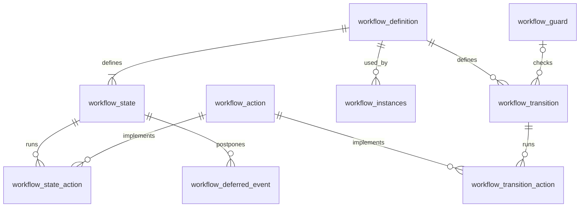

# Database design and queries

Every name below is within the `workflow_brain` schema. `workflow_instances`
keeps its original plural name so existing data and V1 migration stay intact.

## Definition tables: shared rules

| Table | Key columns and relationships |
| --- | --- |
| workflow_definition | definition_id PK; workflow_key + version unique; status DRAFT/ACTIVE/RETIRED; created_at |
| workflow_state | (definition_id, state_code) PK; initial_state; terminal_state; definition FK |
| workflow_transition | transition_id PK; definition_id; source_state; event_code; target_state; transition_kind; optional guard_code FK; source/target composite FKs to states; (definition_id, source_state, event_code) unique |
| workflow_action | action_code PK; description |
| workflow_guard | guard_code PK; description |
| workflow_state_action | (definition_id, state_code, phase, execution_order) PK; action_code FK; phase ENTRY/EXIT/STATE; composite state FK |
| workflow_transition_action | (transition_id, execution_order) PK; action_code FK |
| workflow_deferred_event | (definition_id, state_code, event_code) PK; composite state FK |

## Execution and retry tables

| Table | Columns |
| --- | --- |
| workflow_instances | reference_id PK; definition_id FK; current_state; machine_context TEXT; context_format_version; created_at; updated_at; composite (definition_id, current_state) FK |
| workflow_request_replay | idempotency_key PK; request_fingerprint; response_json TEXT; http_status; created_at; completed_at |
| workflow_transition_history | history_id identity PK; reference_id FK; definition_id FK; source_state; event_code; target_state; request_id; idempotency_key; created_at |

machine_context is versioned JSON, not a Java object serialized into unreadable
bytes. It contains formatVersion, state and variables. current_state remains
separate for ordinary SQL queries; reads reject a mismatching snapshot.



workflow_request_replay is independent: GET_STATE and error reservations need not
have a successful workflow row. Its fingerprint binds a key to the request.

## See the rules (source state -> event -> next state)

```sql
SELECT d.workflow_key, d.version, t.source_state, t.event_code, t.target_state,
       t.transition_kind, t.guard_code
FROM workflow_brain.workflow_transition t
JOIN workflow_brain.workflow_definition d USING (definition_id)
ORDER BY d.workflow_key, d.version, t.transition_id;
```

## See a reference's current state and possible next steps

```sql
SELECT i.reference_id, i.current_state, t.event_code AS next_event,
       t.target_state AS next_state
FROM workflow_brain.workflow_instances i
LEFT JOIN workflow_brain.workflow_transition t
  ON t.definition_id = i.definition_id AND t.source_state = i.current_state
WHERE i.reference_id = 'APP-101';
```

This can return multiple rows for branching definitions. There is no duplicated
next_state column in workflow_instances that could drift from the rules.

## See saved context and retry results

```sql
SELECT reference_id, current_state, definition_id, machine_context
FROM workflow_brain.workflow_instances WHERE reference_id = 'APP-101';

SELECT idempotency_key, http_status, created_at, completed_at, response_json
FROM workflow_brain.workflow_request_replay
WHERE idempotency_key = 'APP-101-otp';
```

After CREATE, one instance row is inserted. After OTP_VERIFIED that row changes
from OTP_VERIFICATION to PROFILE_DETAILS, along with its context and updated_at.
Shared definition rows are reused. With a retry key, one replay row is reserved
and later completed with the successful response. Without a key, no replay row
is added. V3 adds durable applied-transition history independently of whether a
retry key was provided.

## Publishing a new version

Use a new Flyway migration. Insert workflow_definition with a new definition_id
and incremented version, then its states, transitions and bindings. Review its
graph and registered behavior names before activation. Existing references retain
their definition_id; only new CREATE requests select the latest ACTIVE version.
Do not edit/delete rules referenced by existing instances.

The seeded definition has five states, four external transitions, four actions,
one guard, fifteen state action bindings and four transition action bindings.
It has no deferred events or internal transitions because onboarding currently
does not require them. The tables and engine also support configuring internal
transitions and deferred events for other workflow definitions.

## See applied transition history

```sql
SELECT history_id, source_state, event_code, target_state,
       request_id, idempotency_key, created_at
FROM workflow_brain.workflow_transition_history
WHERE reference_id = 'APP-101'
ORDER BY created_at, history_id;
```

The index (reference_id, created_at) supports lookups by reference and time.
history_id breaks timestamp ties: PostgreSQL CURRENT_TIMESTAMP can be identical
for multiple transitions in the same transaction. Sequence gaps after rollback
are normal and do not indicate missing committed history.

Only applied events insert rows. A same-state internal transition also inserts a
row. A deferred event is recorded when applied, with the request_id and
idempotency_key of the request that triggered its replay. Idempotency retries,
rejections, GET_STATE and CREATE add no history. Prior transitions are not backfilled.
History insertion, context persistence and successful response replay storage
share the workflow transaction. V1/V2 migrations and existing contexts are unchanged.
