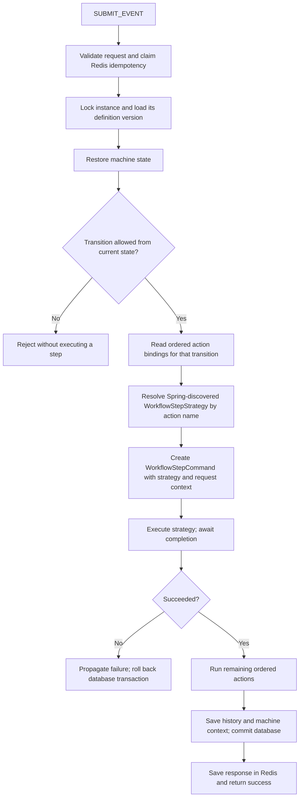

# Configurable workflow steps

CREATE selects a workflow definition and starts its initial state. GET_STATE reads
saved progress. SUBMIT_EVENT uses the instance's definition to select a transition
and its configured step implementation. The gateway has no step-specific routing.

## What selects the next state?

PostgreSQL defines the workflow graph, not the Java strategy:

- `workflow_definition` identifies a workflow key and version.
- `workflow_state` defines its states and initial/terminal flags.
- `workflow_transition` defines source state, requested event and target state.
- `workflow_action.action_name` identifies a registered Java implementation.
- `workflow_transition_action` binds implementations to transitions in execution order.

State names, event names and action names have separate purposes. For example:

| Source state | Requested event | Step action name | Java strategy | Target state |
| --- | --- | --- | --- | --- |
| OTP_VERIFICATION | VERIFY_OTP | verifyOtp | VerifyOtpStepStrategy | PROFILE_DETAILS |
| PROFILE_DETAILS | UPDATE_PROFILE | updateProfile | UpdateProfileStepStrategy | ACCOUNT_STATEMENT_UPLOAD |
| ACCOUNT_STATEMENT_UPLOAD | UPLOAD_ACCOUNT_STATEMENT | uploadAccountStatement | UploadAccountStatementStepStrategy | UDYAM_DOCUMENT_UPLOAD |
| UDYAM_DOCUMENT_UPLOAD | UPLOAD_UDYAM_DOCUMENT | uploadUdyamDocument | UploadUdyamDocumentStepStrategy | COMPLETED |

The same strategy can be reused by different workflows, events, states and versions.
Two workflows can bind the same event to different strategies. Resolution uses the
instance's pinned definition and transition bindings, not a global event switch.

## How submission works



Unknown action names fail when constructing the model. Duplicate strategy names,
blank names and names reserved for bookkeeping fail during bean initialization.
Business steps require the submission context; starting a machine does not execute
its outgoing transition steps.

## Strategy and command responsibilities

[WorkflowStepStrategy](../src/main/java/com/example/statemachine/strategy/WorkflowStepStrategy.java)
is the extension point: provide a stable action name and implement `execute`.
Spring discovers implementations through `@Component`; no registry edit is needed.

[WorkflowStepCommand](../src/main/java/com/example/statemachine/command/WorkflowStepCommand.java)
encapsulates the selected strategy and the context for one invocation. Its
`execute()` calls the strategy. It is created for that submission, not shared
between requests or stored in the database.

[WorkflowStepContext](../src/main/java/com/example/statemachine/dto/workflow/WorkflowStepContext.java)
contains request metadata, definition ID, workflow key and definition version.
Request metadata includes the reference ID, request ID, event and idempotency key.
The definition supplies workflow information even though SUBMIT_EVENT does not
accept a workflowKey from the caller. Strategies should not hardcode a next state.

[WorkflowBehaviorRegistry](../src/main/java/com/example/statemachine/statemachine/WorkflowBehaviorRegistry.java)
adapts a registered strategy to a StateMachine action. The model factory awaits
transition actions in configured order. Errors mark the machine failed and reach
the execution service before history/context persistence.

## Implement the existing TODOs

Business integrations are intentionally placeholders:

- [VerifyOtpStepStrategy](../src/main/java/com/example/statemachine/strategy/step/VerifyOtpStepStrategy.java)
- [UpdateProfileStepStrategy](../src/main/java/com/example/statemachine/strategy/step/UpdateProfileStepStrategy.java)
- [UploadAccountStatementStepStrategy](../src/main/java/com/example/statemachine/strategy/step/UploadAccountStatementStepStrategy.java)
- [UploadUdyamDocumentStepStrategy](../src/main/java/com/example/statemachine/strategy/step/UploadUdyamDocumentStepStrategy.java)

Each currently logs `workflow_step_placeholder` and returns successfully so the
testing workflow can advance. It does not perform or confirm a real business task.
Fill in the TODOs when the external APIs and required inputs have been decided.
Use Lombok `@AllArgsConstructor` when adding injected client dependencies.

Required implementation behavior:

1. Validate the step's required inputs once their contract is defined.
2. Call the external service and wait for its result.
3. Treat a business rejection or timeout as a failure; propagate an exception.
4. Return normally only when the required task succeeded.
5. Pass a stable idempotency token to external services where supported.

Strategies are singleton Spring beans: keep per-request data in the supplied
context or local variables. Do not store it in mutable strategy fields. The current
HTTP payload must still be `{}`; adding OTP/profile/document inputs later requires
updating the API DTOs, Gson binding, validation, Swagger and fingerprint policy.

JDBC rollback cannot undo a completed external call. A retry after rollback can
invoke the strategy again; external effects need their own idempotency or an
appropriate recovery/outbox design. The current implementation does not introduce
external clients, credentials, retries or response contracts.

## Add a new state and implementation

1. Add a stable action-name constant in `WorkflowBehaviorConstants`.
2. Add a Spring component implementing `WorkflowStepStrategy`:

   ```java
   @Component
   public class AddressCheckStepStrategy implements WorkflowStepStrategy {
       @Override
       public String actionName() {
           return WorkflowBehaviorConstants.CHECK_ADDRESS;
       }

       @Override
       public void execute(WorkflowStepContext context) throws Exception {
           // TODO: Implement the address check. Propagate failures.
       }
   }
   ```

3. In a new definition version, insert the new state and its transitions.
4. Insert `workflow_action` with the exact name returned by `actionName()`.
5. Bind that action to the appropriate transition using `workflow_transition_action`.
   Use execution order 0 for the business step, then later orders for bookkeeping.
6. Activate the new definition version and test success, failure and retry paths.

No changes are required to the controller, gateway, command dispatcher, event
processor or model factory. If a new state reuses an existing implementation, only
its database configuration needs to change. Multiple actions per transition are
supported and run sequentially.

## Reorder steps or change a workflow

Change source/target relationships in a new definition version. Reuse existing
action bindings, or bind different strategies. Keep one initial state, at least
one terminal state, no outgoing terminal transitions and all states reachable.
State row order and numeric IDs do not define execution order; transitions do.

CREATE uses the highest ACTIVE version for its workflow key. Existing instances
remain on their original definition version. This protects an in-flight application
from silently being moved to a different process. Moving existing instances to a
new graph requires an explicit state/context/history migration policy; no automatic
upgrade endpoint is implemented.

The current testing baseline V2 includes the four step-action bindings. Reset and
reseed the testing schema and Flyway history to apply the changed baseline.
For a retained database, use a new migration rather than altering applied history.
